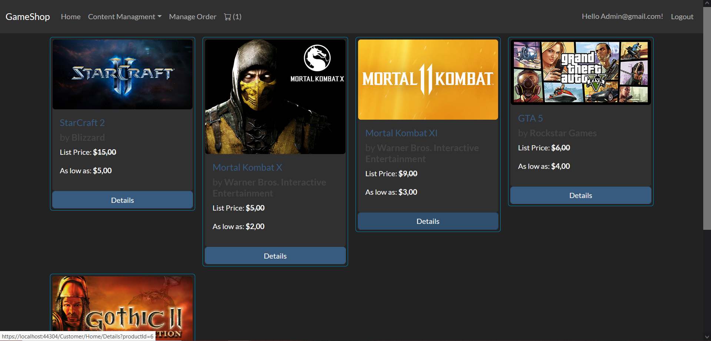
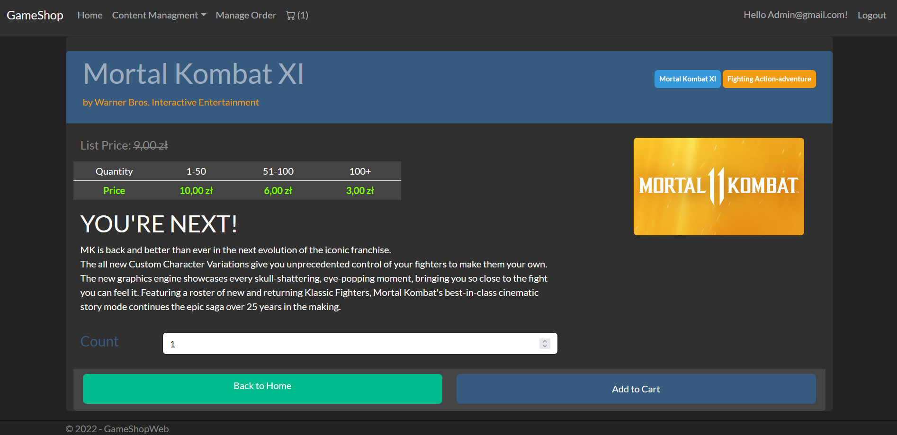
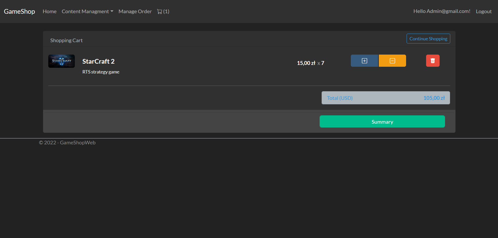
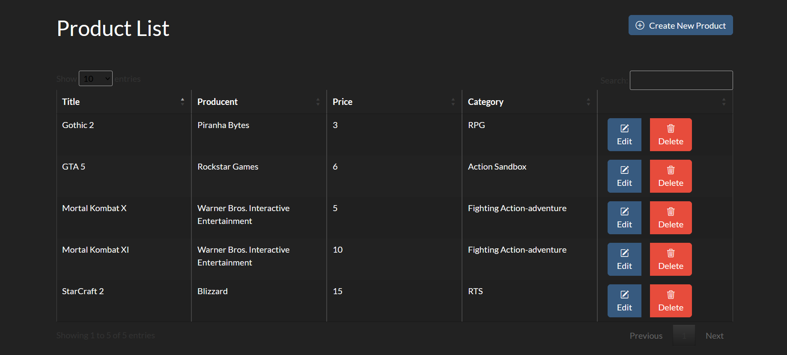

# GameShop

**Online video game store built with ASP.NET Core MVC (.NET 6), EF Core and Stripe.**

Customers browse games, add them to a cart and pay with Stripe. Staff manage the catalog and process orders from an admin panel.




## Features

**Store**
- Game catalog with product details and quantity-based pricing (1–50, 51–100, 100+ copies)
- Shopping cart kept in the session, order summary and Stripe Checkout payment
- Registration and login with ASP.NET Core Identity, plus optional Facebook login

**Admin panel**
- Create, edit and delete products (with cover image upload), categories, cover types and companies
- Order management: filter by status, start processing, ship, cancel with a Stripe refund
- Tables with search, sorting and paging (DataTables) and toast notifications (toastr)

**Roles**
- `Admin` and `Employee` manage the store
- `Individual` customers pay at checkout
- `Company` customers can order now and pay later (delayed payment)

## Screenshots

| Product details | Shopping cart |
| --- | --- |
|  |  |



## Architecture

The solution is split into layers:

| Project | Responsibility |
| --- | --- |
| `GameShopWeb` | MVC app with two areas: `Customer` (store, cart) and `Admin` (catalog and order management) |
| `GameShop.DataAccess` | EF Core `DbContext`, migrations, generic repository and Unit of Work |
| `GameShop.Models` | Entities and view models |
| `GameShop.Utility` | Constants (roles, order and payment statuses), Stripe settings |

## Running locally

Requirements: .NET 6 SDK and SQL Server (LocalDB works).

1. Set the connection string in `GameShopWeb/appsettings.json` if you don't use the default local server.
2. Add your Stripe **test** keys with User Secrets:
   ```bash
   dotnet user-secrets set "Stripe:SecretKey" "sk_test_..." --project GameShopWeb
   dotnet user-secrets set "Stripe:PublishableKey" "pk_test_..." --project GameShopWeb
   ```
3. Optional: to enable Facebook login, add your Facebook app credentials the same way:
   ```bash
   dotnet user-secrets set "Authentication:Facebook:AppId" "..." --project GameShopWeb
   dotnet user-secrets set "Authentication:Facebook:AppSecret" "..." --project GameShopWeb
   ```
4. Run the app:
   ```bash
   dotnet run --project GameShopWeb
   ```
   The database is created and seeded with roles and an admin account on first start.
